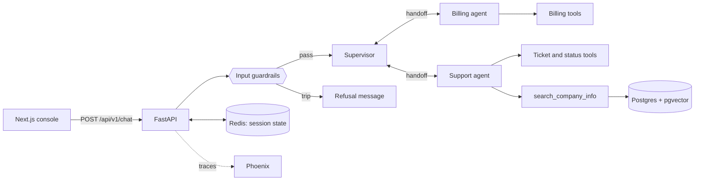

# Customer Service Agent

A multi-agent customer service assistant built on the [OpenAI Agents SDK](https://openai.github.io/openai-agents-python/). A supervisor agent routes each conversation to a billing or support specialist, input guardrails screen every message, a RAG tool answers company questions from a knowledge base, and an eval harness measures routing, tool use, guardrails, latency, and answer quality.

> **This is a demo project.** "Brightloop" (a webhook-delivery SaaS) and its persona "Zara" are fictional. All customer data, invoices, tickets, and knowledge-base content are invented mock data, and the billing tools act on an email address with no authentication. It is not meant to be deployed as-is.

## How it works



- **Hub-and-spoke routing.** The supervisor detects intent and hands off to Billing or Support. Specialists hand back to the supervisor for off-topic requests; there are no specialist-to-specialist handoffs. Handoffs are invisible to the user, who sees one continuous conversation with one persona.
- **Sessions.** Conversation history and the current agent are stored in Redis per session (UUID v4) with a TTL, so a follow-up message continues with the agent that was handling the conversation.
- **Guardrails.** Three input guardrails run on every message: message length, prompt injection, and off-topic. The latter two are small LLM classifiers. A tripped guardrail returns a refusal and is reported in the response.
- **RAG.** A single vector search per query (`text-embedding-3-small`, cosine similarity via pgvector). Markdown knowledge files are chunked and embedded at startup, with SHA-256 change detection so unchanged files are not re-embedded.
- **Observability.** OpenTelemetry traces (including guardrail spans) go to [Arize Phoenix](https://github.com/Arize-ai/phoenix) when `PHOENIX_COLLECTOR_ENDPOINT` is set.
- **Dev console.** The Next.js frontend shows the chat alongside the active agent, its tools and handoffs, triggered guardrails, and the tool-call events for each turn.

## Quickstart

Requires Docker and an OpenAI API key.

```bash
# .env at the repo root
OPENAI_API_KEY=sk-...
POSTGRES_PASSWORD=choose-something

docker compose up --build
```

| Service | URL |
|---|---|
| Dev console | http://localhost:3000 |
| API | http://localhost:8000/api/v1 (`/health`, `/agents`, `/chat`) |
| Phoenix (traces) | http://localhost:6006 |
| RedisInsight | http://localhost:5540 |

Try it with the mock accounts: `alice@example.com` (Pro), `bob@example.org` (Starter), `carol@example.net` (Business). For example: *"What plan am I on? My email is alice@example.com"*, then *"Is Brightloop SOC 2 compliant?"*

```bash
curl -s localhost:8000/api/v1/chat -H 'content-type: application/json' \
  -d '{"session_id":"'$(uuidgen | tr A-Z a-z)'","message":"What plans do you offer?"}'
```

### Running the backend without Docker

```bash
docker compose up postgres redis phoenix
cd backend
uv run uvicorn api.app:app --app-dir src --reload
```

## Tests and evals

```bash
cd backend
uv run pytest tests/unit          # 274 unit tests, no network needed
uv run pytest tests/integration   # needs Redis
uv run ruff check src tests && uv run ruff format --check src tests
```

CI enforces lint, formatting, and 80% coverage.

The eval harness (`backend/evals/`) runs 40 conversation cases against the real agents with real model calls:

```bash
cd backend
uv run python -m evals --skip-tags db --threshold 0.9
```

Cases live in YAML files (routing, billing, support, guardrails). Each declares only the expectations it cares about, and is graded on:

- **routing**: did the conversation end at the expected agent
- **tools**: were the expected tools called, in order (extra calls are allowed)
- **guardrails**: did the expected guardrails trip
- **latency**: within the case's latency budget, when one is set
- **quality**: an LLM-as-judge grades the answer against a case-specific rubric, when one is set

The run writes a JSON report with pass rates by category and token usage, can export results to Phoenix, and exits non-zero below the threshold, which is how CI gates it.

## Configuration

Settings load from environment variables or `.env` (see `backend/src/config.py`). The useful ones:

| Variable | Default | Purpose |
|---|---|---|
| `OPENAI_API_KEY` | required | OpenAI access |
| `SUPERVISOR_MODEL`, `GUARDRAIL_MODEL` | `gpt-4o-mini` | Routing and guardrail classifiers |
| `BILLING_MODEL`, `SUPPORT_MODEL` | `gpt-4o` | Specialist agents |
| `MAX_MESSAGE_LENGTH` | `1000` | Message length guardrail |
| `RAG_TOP_K` | `2` | Chunks returned per knowledge-base search |
| `SESSION_TTL_SECONDS` | `3600` | Redis session lifetime |
| `PHOENIX_COLLECTOR_ENDPOINT` | unset | Tracing is disabled when unset |
| `LOG_LEVEL` | `INFO` | Python log level |

## Repository layout

```
backend/
  src/agent/        supervisor, billing, support agents; guardrails; registry
  src/rag/          knowledge-base ingestion, search tool, markdown sources
  src/services/     mock billing and support backends
  src/store/        Redis conversation store, pgvector store
  src/api/          FastAPI app, routes, chat service, middleware
  evals/            cases, graders, LLM judge, runner, reports
  tests/            unit and integration tests
frontend/           Next.js dev console
docker-compose.yml  postgres + pgvector, redis, phoenix, backend, frontend
```

## Known limitations

- No authentication, rate limiting, or CORS configuration on the API. Every chat request makes several paid model calls, so do not expose it publicly.
- Billing and support backends are in-memory mocks; actions like plan changes and refunds do not persist.
- RAG is deliberately simple: one vector search with a small `top_k`, so broad questions (for example about pricing tiers) can miss relevant chunks.
- Guardrails are LLM classifiers and are probabilistic; they reduce risk but do not eliminate it.
- Tool-call arguments and outputs are returned to the client for the dev console. A production API should not expose them.

## License

No license is granted. The source is published so it can be read and reviewed; please do not copy, redistribute, or reuse it without permission. All rights reserved.
